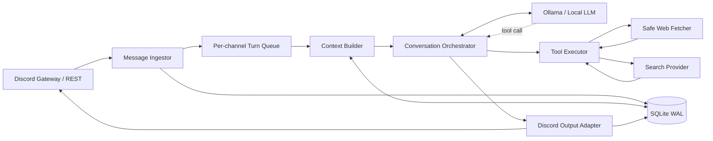
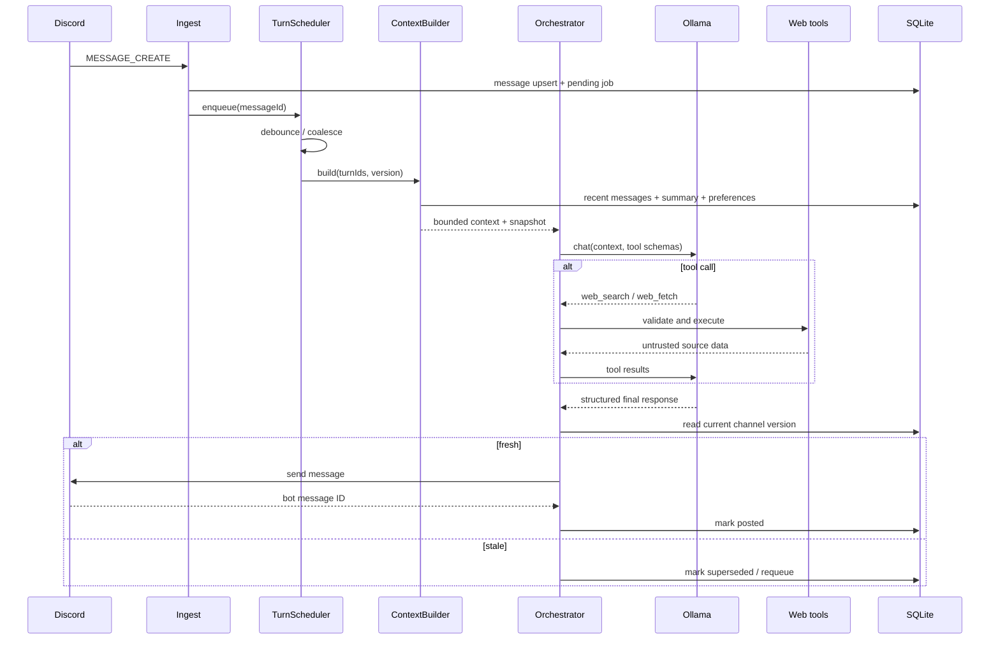

# システム・詳細設計書

## 1. アーキテクチャ方針

MVP は `home-server-2` 上で動く単一 Node.js プロセスと、同一ホストの Ollama、SQLite から構成する。外部公開する HTTP サーバーや WebUI は持たない。Discord Gateway へは外向き WebSocket、検索サービスとWebページへは外向き HTTPS で接続する。

次の境界を明確に分離する。

- Discord は入出力アダプターであり、会話ロジックを持たない。
- 会話オーケストレーターは Discord のクラスへ直接依存しない。
- LLM は交換可能な `ChatModel` interface とする。
- 検索・ページ取得は LLM から直接実行せず、登録済み `Tool` だけを実行する。
- SQLite は repository の背後へ隠し、domain/service が SQL を組み立てない。
- すべての設定は起動時に検証し、不正な構成では Discord へ接続しない。

## 2. 論理構成



## 3. 技術スタック

| 領域         | 採用技術                                  | 理由                                                  |
| ------------ | ----------------------------------------- | ----------------------------------------------------- |
| Runtime      | Node.js 24                                | JavaScript ESM、長期サポート、Discord SDKとの相性     |
| Discord      | `discord.js`                              | Gateway、REST、rate limit、slash command対応          |
| LLM          | Ollama HTTP API                           | ローカルNVIDIA推論、tool calling、structured output   |
| DB           | SQLite WAL + `better-sqlite3`             | 単一ホスト・単一プロセスで運用が軽い                  |
| 設定検証     | `zod`                                     | env、YAML、tool arguments、LLM JSONを同じschemaで検証 |
| 設定ファイル | `yaml`                                    | チャンネルごとの設定を人がレビューしやすい            |
| ログ         | `pino`                                    | 高速なJSONログとredaction                             |
| Queue        | 小規模な自作scheduler + `AbortController` | channel key直列化、debounce、stale cancellationに限定 |
| HTTP         | Node組み込み`fetch`                       | timeoutとredirect制御をラップして利用                 |
| Search       | self-hosted SearXNG                       | 外部providerアカウント不要、JSON検索API               |
| 本文抽出     | `@mozilla/readability` + 軽量DOM実装      | Webページからナビ等を除いて本文を抽出                 |
| Test         | Node.js組み込みtest runner                | `node --test`、mock、fake timerを利用                 |
| Lint/format  | ESLint + Prettier                         | JavaScriptの品質統一                                  |
| Deployment   | Docker Compose                            | restart policy、依存分離、再現可能な配備              |

依存バージョンは実装開始日に公式リリースを再確認し、lockfileで固定する。文書には更新されやすいpatch versionを固定しない。

## 4. 実行時コンポーネント

### 4.1 `DiscordInputAdapter`

責務:

- Clientの生成とintent設定
- `clientReady`、`messageCreate`、`messageUpdate`、`messageDelete` の購読
- Guild/channels allowlist の最初の拒否判定
- Discord objectを内部の `InboundMessage` へ変換
- Bot、Webhook、system message、DMの除外
- Gateway eventを `MessageIngestService` へ渡す

禁止事項:

- LLM呼び出し
- prompt構築
- DBへ直接SQL発行
- 生のmessage本文をログへ記録

### 4.2 `MessageIngestService`

責務:

- message IDによるupsertと冪等性
- 編集・削除状態の更新
- channel activity versionのincrement
- 新規対象メッセージに対するturn bufferへのenqueue
- correlation IDの発行

トランザクション境界:

1. `messages`へupsert。
2. `channel_state.version`をincrement。
3. `response_jobs`へpending jobまたはturn buffer情報を記録。
4. commit後にin-memory schedulerへ通知。

commit前にプロセスが落ちた場合は何も処理されず、Gateway再受信または起動時reconcileで回復する。commit後、scheduler通知前に落ちた場合は起動時にpending jobを拾う。

### 4.3 `TurnScheduler`

channel/thread IDをkeyに次を保証する。

- 同一keyの生成は同時に1つだけ。
- 新規メッセージ受信後2.5秒待つ。
- 待機中の新着でtimerを延長するが、最初のメッセージから8秒を超えない。
- debounce窓の全メッセージを一つのturnへ束ねる。
- 全体同時生成数は既定1。
- queue overflow時は発言を捨てず、複数メッセージを一つのsummary-only turnへ圧縮する。
- shutdown時は新規受付を止め、生成を最大30秒待ってから中断する。

内部状態例:

```js
/** @typedef {'idle'|'debouncing'|'generating'|'posting'|'backoff'} ChannelRunState */

/**
 * @typedef {Object} ChannelQueue
 * @property {string} channelKey
 * @property {ChannelRunState} state
 * @property {string[]} pendingMessageIds
 * @property {number} firstQueuedAt
 * @property {number} lastQueuedAt
 * @property {AbortController|null} generationAbort
 */
```

### 4.4 `ContextBuilder`

入力:

- channel key
- turn message IDs
- current channel version
- channel config

出力:

- system/developer instruction
- current date/time/timezone
- session summary
- recent messages
- current turn
- 明示されたparticipant preferences
- token budget report
- generation snapshot

`ContextBuilder` は古いmessageから順に無制限投入しない。詳細は `04-conversation-memory.md` に従う。

### 4.5 `ConversationOrchestrator`

責務:

1. モードに応じてresponse decisionを取得。
2. LLMへ会話contextとtool schemaを渡す。
3. tool callの引数をZodで検証。
4. 許可されたtoolを上限内で実行。
5. tool resultを非信頼データとしてLLMへ戻す。
6. final responseをschema検証。
7. stale判定。
8. output policyを適用して投稿アダプターへ渡す。

tool loopは最大3周とする。上限到達時はtoolを追加実行せず、得られた範囲で回答するか、確認できないと返す。

### 4.6 `ChatModel`

```js
/**
 * @typedef {Object} ChatRequest
 * @property {Array<Object>} messages
 * @property {Array<Object>} tools
 * @property {Object|undefined} responseSchema
 * @property {number} timeoutMs
 * @property {AbortSignal} signal
 */

/**
 * @interface
 */
class ChatModel {
  /** @param {ChatRequest} request */
  async chat(request) {}

  async health() {}
}
```

Ollama実装は `http://127.0.0.1:11434` のみに接続する。thinking/reasoning内容はDiscordへ出さず、通常ログにも残さない。structured outputで `action` と `content` を検証する。

### 4.7 `ToolExecutor`

登録可能toolはMVPで次の2つだけとする。

- `web_search({ query, freshness, maxResults })`
- `web_fetch({ url })`

tool registryにない名前は実行しない。引数はJSON schemaとZodの両方で検証し、呼出回数、timeout、取得byte数をexecution budgetで制限する。shell、filesystem、LAN探索、Discord管理操作をtoolとして公開しない。

### 4.8 `DiscordOutputAdapter`

責務:

- response textの正規化
- `@everyone`、role mention、意図しないuser mentionの無効化
- Discord上限に合わせた段落単位の分割
- typing表示
- message送信と返却IDの保存
- 429を含む一時エラーのlibrary標準retryとの協調
- permission errorを恒久エラーとして扱う

原則は通常のchannel messageとして投稿する。質問者が明確な単発会話ではreplyを使えるが、複数人のturnを一人のmessageへreplyして代表させない。

## 5. ディレクトリ構成

```text
Discord-AI-Chat/
├─ .docs/
├─ config/
│  ├─ bot.example.yaml
│  └─ prompts/
│     ├─ identity.md
│     ├─ conversation.md
│     └─ web-safety.md
├─ migrations/
├─ scripts/
│  ├─ register-commands.js
│  ├─ doctor.js
│  ├─ backup.js
│  └─ benchmark-model.js
├─ src/
│  ├─ index.js
│  ├─ bootstrap.js
│  ├─ config/
│  │  ├─ load-config.js
│  │  └─ schema.js
│  ├─ discord/
│  │  ├─ input-adapter.js
│  │  ├─ output-adapter.js
│  │  ├─ commands.js
│  │  └─ normalize-message.js
│  ├─ conversation/
│  │  ├─ ingest-service.js
│  │  ├─ turn-scheduler.js
│  │  ├─ context-builder.js
│  │  ├─ orchestrator.js
│  │  ├─ session-service.js
│  │  ├─ summary-service.js
│  │  ├─ response-policy.js
│  │  └─ stale-policy.js
│  ├─ ai/
│  │  ├─ ollama-chat-model.js
│  │  ├─ schemas.js
│  │  └─ prompt-renderer.js
│  ├─ tools/
│  │  ├─ tool-executor.js
│  │  ├─ web-search.js
│  │  ├─ safe-web-fetch.js
│  │  └─ source-ranker.js
│  ├─ preferences/
│  │  └─ preference-service.js
│  ├─ storage/
│  │  ├─ database.js
│  │  └─ repositories/
│  ├─ observability/
│  │  ├─ logger.js
│  │  └─ health.js
│  └─ shared/
│     ├─ errors.js
│     ├─ ids.js
│     └─ time.js
├─ test/
│  ├─ unit/
│  ├─ integration/
│  ├─ fixtures/
│  └─ conversation-evals/
├─ .env.example
├─ .gitignore
├─ package.json
└─ package-lock.json
```

## 6. 設定設計

### 6.1 秘密値

`/etc/discord-ai-chat/bot.env` など、service userだけが読めるファイルへ置く。

```dotenv
DISCORD_BOT_TOKEN=...
SEARCH_API_KEY=...
```

秘密値ファイルはmode `0600`、所有者はservice userとする。

### 6.2 非秘密設定

```yaml
schemaVersion: 1
timezone: Asia/Tokyo

discord:
  guildId: '123456789012345678'
  adminRoleIds: ['123456789012345679']
  channels:
    - id: '123456789012345680'
      mode: all
      persona: friendly
      debounceMs: 2500
      maxDebounceMs: 8000
      sessionIdleMinutes: 15

llm:
  provider: ollama
  baseUrl: http://127.0.0.1:11434
  model: TO_BE_SELECTED_BY_BENCHMARK
  contextTokens: 8192
  maxOutputTokens: 500
  timeoutMs: 45000
  keepAlive: 15m

web:
  enabled: true
  provider: ollama
  maxSearchesPerTurn: 2
  maxFetchesPerTurn: 3
  timeoutMs: 8000
  maxBytesPerPage: 1048576
  cacheMinutes: 30

privacy:
  messageRetentionHours: 24
  sessionSummaryRetentionHours: 24
  webCacheRetentionHours: 6

logging:
  level: info
  includeMessageContent: false
```

起動時検証:

- IDは10進数字文字列。
- channel IDは重複不可。
- `baseUrl`はloopbackだけを許可。
- contextとoutputの合計がmodel上限を超えない。
- retentionは0以上の上限付き整数。
- 本番環境で`includeMessageContent: true`は禁止。
- 検索有効時はproviderに必要なcredentialの存在を確認。

## 7. メッセージ処理シーケンス



## 8. Job状態機械

```text
pending -> debouncing -> generating -> posting -> posted
                         |     |         |
                         |     |         +-> failed_permanent
                         |     +-> superseded -> pending(new turn)
                         +-> retry_wait -> generating
```

| 状態               | 説明                                   |
| ------------------ | -------------------------------------- |
| `pending`          | DBに記録済み、scheduler未着手          |
| `debouncing`       | 同じturnへ入る新着を待機               |
| `generating`       | context snapshotを使ってLLM処理中      |
| `posting`          | Discord送信要求中                      |
| `posted`           | Discord message ID保存済みの終端       |
| `retry_wait`       | Ollama/検索等の一時障害。backoff待機   |
| `superseded`       | 新しい会話により生成結果を破棄した終端 |
| `failed_permanent` | 権限不足・設定不備等、retryしない終端  |

状態遷移はDB transactionで行う。`posted`へはDiscordのmessage IDを保存できた場合だけ遷移する。送信成功後、応答を受ける前にプロセスが落ちる曖昧状態に備え、投稿へ短いjob markerを埋め込む方式はDiscord表示を汚すため採らず、起動直後にBot自身の直近投稿とjob時刻を照合するreconcileを実装する。

## 9. エラー方針

| エラー                    | retry          | 利用者への表示                      | ログ                       |
| ------------------------- | -------------- | ----------------------------------- | -------------------------- |
| Discord 429               | SDKに従う      | 通常なし                            | route、retryAfter          |
| Discord permission denied | なし           | 管理者向けstatus                    | guild/channel/error code   |
| Ollama timeout            | 1回            | 「少し混み合っている」              | duration、model、job ID    |
| Ollama OOM                | 小contextで1回 | 再失敗時のみ短い障害表示            | VRAM取得値、context量      |
| 検索timeout               | 最大1回        | 検索できなかった旨                  | provider、duration         |
| Web fetch拒否             | なし           | 原則なし。必要なら読めないURLと表示 | reason category、host hash |
| LLM schema不正            | retryなし      | 生出力を破棄して定型文              | model_output_invalid       |
| SQLite busy               | 短いbackoff    | なし                                | duration                   |
| SQLite corruption         | 自動復旧しない | statusで停止中                      | 高優先度alert              |

ログへmessage本文、検索query全文、Web本文、secret、LLMのthinkingを含めない。

LLMの最終回答はDiscordへ送る直前にoutput guardを通す。内部話者labelとcontext message IDは除去し、system promptの長い一致、内部section見出し、canary、非信頼データ用tagを検出した場合は回答全体を定型文へ置き換える。guardのログには理由分類だけを残し、検出本文は記録しない。

## 10. 拡張境界

- 音声機能を追加する場合は `DiscordVoiceAdapter` と `SpeechSynthesizer` を別プロセス化し、会話コアへ混ぜない。
- PostgreSQL化はrepository差替えで行い、domain IDやjob stateは維持する。
- 複数Guild対応ではguild keyを全テーブル・queue・cacheへ含め、privacy boundaryを跨がせない。
- 複数GPUや別LLMホスト化では `ChatModel.baseUrl` を変更するが、Ollama APIをLAN公開する場合は認証proxyとfirewallが別途必須となる。
