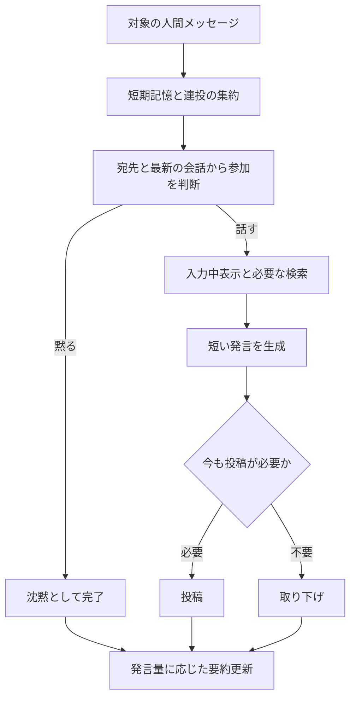

# AIが参加するグループチャットへの機能見直し

更新日: 2026-11-12

状態: 機能レビューと改訂仕様。その後の実装依頼に基づき、主要な参加制御・沈黙・再評価・文脈更新を実装した。[実装・設定・検証状況](./11-group-chat-implementation.md)を参照する。以下の問題一覧は見直し開始時のコードに対する記録であり、本番設定の変更記録ではない。

## 1. 作りたい体験

人間同士の会話にAIも一人の参加者として加わる。質問に答えるだけでなく、冗談に乗る、感想を言う、話の続きを受けることもできる。一方で、すべての投稿に答えたり、常に会話の中心になったりする必要はない。

**会話を追うことと、発言することを分ける。黙っている間も流れを理解し、加わる意味があるときに話す。**

- AIへの依頼には応じる。ただし、取り消しや「もう解決した」後は投稿しない。
- 人間同士で話が進んでいるなら、そのやり取りを優先する。
- 呼ばれていなくても、話の流れに合う一言があれば参加できる。
- 笑い、挨拶、お礼、会話の締めに毎回返す必要はない。
- 会話が止まったことだけを理由に、話題や質問を自動投稿しない。

回答率を上げることを成功条件にしない。「呼びかけには応じる」「人間の会話を奪わない」「参加した発言に意味がある」を合わせて評価する。

## 2. 見直し開始時の実装とのずれ

ここでいう現行は、機能見直しを始めた時点の作業ツリーであり、本番環境の再調査結果ではない。改修後の挙動は実装記録へ分ける。

| 優先 | 現行の動きと確認箇所                                                                                                                              | グループチャットで起きること                                     | 見直し                                                                              |
| ---- | ------------------------------------------------------------------------------------------------------------------------------------------------- | ---------------------------------------------------------------- | ----------------------------------------------------------------------------------- |
| P0   | 設定例と設定省略時が`all`。[設定](../src/config/load-config.js)の`channelSchema`、[設定例](../config/bot.example.yaml)                            | 全返答が標準の体験になる                                         | 標準の参加方針を`ambient`へ変える。既存の保存済みモードは移行対象として別途確認する |
| P0   | [orchestrator](../src/conversation/orchestrator.js)の`respond`が`all`の`silent`を`respond`へ変更し、空なら「うん、流れは見てるよ。」を補う        | 黙る判断が投稿へ変わる                                           | 通常運用では沈黙を覆さない。定型の相づちで投稿件数を埋めない                        |
| P0   | [bot](../src/discord/bot.js)の`processTurn`が判断前にtypingし、orchestratorが判断前に検索する                                                     | 発言しない場面でも入力中表示や外部検索が発生する                 | 参加判定を先に行い、発言するときだけtyping・検索・本文生成する                      |
| P0   | 明示的なBot宛判定は`mention`の受信処理にあり、[context builder](../src/conversation/context-builder.js)は返信先IDを含めるが宛先種別を構造化しない | `ambient`で、Botへの呼びかけと人間への質問を区別する材料が弱い   | Bot宛メンション、Botへの返信、人間への返信を正規化して渡す                          |
| P0   | `processTurn`は新着で再生成するが、context builderは元の対象発言より後を除外する。再生成後はversionを再比較しない                                 | 新着による解決・撤回・話題転換を見ず、同じ古い発言へ再回答し得る | 最新の人間の会話を見て投稿可否を再判定する。古い回答を順番どおり消化しない          |
| P1   | `silent`でもjobを`posted`として終了し、要約更新前にreturnする                                                                                     | 沈黙と投稿を区別できず、長い人間同士の会話で要約が更新されない   | `silent`を独立した正常終了にし、要約は人間の発言量に基づいて更新する                |
| P1   | 既存の話題分割は一つのactive sessionを切り替え、複数の発言を時間窓でまとめる                                                                      | 交差する会話を一つの依頼として扱いやすい                         | 返信関係を優先する。話題が変わっただけで無関係な後続発言まで一括移動しない          |
| P1   | [scheduler](../src/conversation/turn-scheduler.js)にdebounceはあるが、cooldown・キュー上限はない                                                  | 連投を束ねてもAIが続けて割り込み、古い回答もたまる               | 自発参加の間隔と保留期限を設ける。負荷時も本文保持と応答義務を混同しない            |
| P1   | `processTurn`は失敗時に一律の謝罪文を送る。構造化失敗も投稿用定型文になる                                                                         | 呼ばれていないのに障害通知で割り込む                             | 自発参加の失敗はログに留める。直接依頼の失敗だけ短く通知する                        |
| P2   | 笑い、挨拶、占い、意見質問などへの文章補正が増えている                                                                                            | 個別表現への対応が主目的になり、参加判断が後回しになる           | 安全な出力検査を残し、会話表現は参加判定と品質評価で調整する                        |

既存の安全なWeb取得、権限制御、短期保存、本人データ削除は土台として残す。モデルを変えるだけでは、上記の参加制御は解決しない。

## 3. 機能をどう扱うか

レビュー中に、別作業で明示コマンド`/ai-image`による画像生成が作業ツリーへ追加された。[画像生成サービス](../src/ai/image-generation-service.js)とコマンド経路を確認し、明示依頼で使う補助機能として維持する。通常会話の参加判断と分け、画像生成を理由に全投稿へ反応する設計にはしない。新しい画像理解・添付解析は引き続き後回しとする。

| 機能                                   | 方針                           | 目指す動き                                                                                 |
| -------------------------------------- | ------------------------------ | ------------------------------------------------------------------------------------------ |
| グループ内の発言参加                   | 最優先で作り直す               | 明示依頼、AIとの続き、自然な参加、人間同士の会話を区別する                                 |
| 短い雑談・冗談・感想                   | 中核として残す                 | 役立つ情報がなくても、場に合う一言で参加できる。毎回説明や質問を付けない                   |
| 質問への回答                           | 残す                           | AI宛の質問を優先する。誰かへの質問を勝手に横取りしない                                     |
| 会話の宛先・返信関係                   | 強化する                       | 誰が誰に話しているかと、AIに今何が求められているかを判断する                               |
| 短期記憶・要約                         | 残して更新条件を変える         | AIが黙っていた会話と、AI自身の回答・未完了依頼も必要な範囲で追う                           |
| 話題の自動分離                         | 補助機能へ整理する             | 別話題を混ぜない。一方で返信による続きはたどり、参加者別の会話を一律に切らない             |
| Web検索                                | 回答の補助手段として残す       | 発言する判断の後、依頼に必要な情報だけを調べる。「今日」などの語だけで会話を調査へ変えない |
| ペルソナ                               | 残す                           | AIとして一貫した話し方を持ち、場の口調へ一時的に合わせる                                   |
| 本人の呼び名・回答長・口調             | 任意機能として残す             | 直接の回答では本人設定を使う。グループ全体への一言はチャンネルの口調を基本にする           |
| 自己紹介・公開リンク登録               | 既存機能を維持し、拡張は後回し | 登録しなくても自然に参加できる。宛先判断をプロフィールへ依存させない                       |
| 状態・停止・再開・削除                 | 必須として残す                 | 利用者がAIの参加状態と保存範囲を確認し、管理者がすぐ停止できる                             |
| モデル・effort切替                     | 運用機能として残す             | 利用者がモデル設定を理解しなくてもグループチャットを使える                                 |
| 全返答モード                           | 通常運用から外す案             | 移行期間は互換・比較検証用として残す。標準にせず、通常の参加品質評価から分ける             |
| 絵文字リアクション                     | 将来候補                       | 本文を増やさず反応する手段。既存権限・イベント・重複処理を検討してから追加する             |
| 画像・添付理解、音声参加               | 後回し                         | まずテキストで適切に参加できることを満たす                                                 |
| 無言時の自動話題提供、定期的な呼びかけ | 今回の範囲外                   | 発言を促すためだけの割り込みを増やさない                                                   |
| 個人の性格推定、過去ログ一括収集       | 追加しない                     | 現在の会話文脈と本人が登録した情報の範囲で動く                                             |

## 4. 参加判断

### 4.1 判断の順序

1. 対象外、他Bot、Webhook、停止中を除外する。停止中の新規本文は保存しない。
2. 人間の発言を短期記憶へ取り込み、連投をまとめる。まだ応答義務は作らない。
3. メンション・返信から宛先を特定する。引用や全体メンションをBotへの依頼と取り違えない。
4. 最新の発言、AIの直近発言、人間の返答、取り消しを見て、参加するか決める。
5. 発言する場合だけtypingを開始し、必要なら検索して本文を作る。
6. 投稿直前に新着、宛先、未解決かどうか、モード、削除・resetを再確認する。
7. 投稿または沈黙として正常終了する。要約更新はどちらの場合も独立して判定する。

参加判定は通常の本文生成より小さな処理にする。明確なモード・宛先・頻度制限はコードで判定し、文脈が必要な部分だけ構造化LLM判定を使う。全投稿に対して話題判定、参加判定、本文生成の重いAPI呼び出しを順番に必須化しない。

### 4.2 場面ごとの基本動作

| 場面                                       | 基本動作                 | 補足                                                         |
| ------------------------------------------ | ------------------------ | ------------------------------------------------------------ |
| `@AI このエラーを調べて`                   | 応答する                 | 自発参加のcooldownに阻まれない。全体の負荷上限は守る         |
| AIの回答へreplyで`それはなぜ？`            | 応答する                 | 該当する回答を文脈へ含める                                   |
| AIと会話中の`もう少し詳しく`               | 応答する                 | 短い継続表現でも、誰への続きかを確認する                     |
| AがBへreplyで質問                          | 原則黙る                 | Bが質問をAIへ明示的に回したら応じる                          |
| 全員への質問で、誰もまだ答えていない       | 少し待ち、参加を検討する | AI宛の質問と同じ優先度にしない                               |
| 人間が答えた、解決した、依頼が取り消された | 黙る・生成を取り下げる   | 同じ説明を後から追加しない                                   |
| AIも交えた冗談の続き                       | 一言で参加できる         | ネタを説明したり、毎回新しい話題を足したりしない             |
| 人間同士がテンポよく雑談中                 | 黙る寄り                 | 有益性だけでなく自然な一言の余地も見る                       |
| `www`、単独絵文字、相づちだけ              | 原則黙る                 | 特定の文字列に定型返答を必須化しない                         |
| 人間同士の挨拶・お礼・締め                 | 原則黙る                 | AIへ向けた挨拶やお礼には短く応じてもよい                     |
| 発言先が不明、判定失敗                     | 自発参加は黙る           | 明示依頼は安全な回答経路へ進める。生成失敗時だけ短く通知する |

これらは「特定の単語なら必ず話す」という規則ではなく、会話例の評価基準にする。AIへの言及だけで直接依頼扱いにしない。

### 4.3 モードと頻度の案

- `ambient`: 標準。明示依頼と続きには応じ、自発参加は場と頻度を見て選ぶ。
- `mention`: Botへの明示メンションと返信だけに応じる。その他の発言も短期文脈として保持する。
- `paused`: 取り込みと応答を停止する。既存データは通常の期限で削除する。
- `all`: 移行期間の互換・比較検証用。通常運用の推奨や合格基準にしない。

初期案は、自発参加のみ前回投稿から20秒程度空け、連続してAIが話さないよう人間の新しい発言を必要とする。AI宛の直接依頼にはこの間隔を適用しない。同じ対象の重複依頼はまとめ、API・キュー上限は直接依頼にも適用する。

既存の2.5秒・最大8秒のdebounceは入力の集約時間であり、「8秒ごとに必ず話す」という意味にしない。沈黙した入力を後から自動的に再キューして、無言を埋める機能も付けない。

## 5. 必要な内部状態

| 状態                          | 目的                                 | 保存範囲                                               |
| ----------------------------- | ------------------------------------ | ------------------------------------------------------ |
| 発言先の種別と根拠            | Bot宛、人間宛、不明を区別する        | 短期メッセージに結び付ける。推測した人間関係は作らない |
| AIの直近発言と対象            | 続きの判定、説明の重複防止           | 対象チャンネル内、既存の本文保持期間以内               |
| 未解決の明示依頼と対象ID      | 人間の回答、取り消し、解決を判別する | 未完了の間だけ。元本文の削除・期限切れに追従する       |
| 直近のAI参加時刻              | 自発参加の頻度を抑える               | チャンネル単位。個人別の活動統計にしない               |
| 参加判断と理由分類            | 黙った理由と障害を区別して検証する   | 本文なしの運用メタデータとして既存の保持期限に従う     |
| 最新メッセージと設定のversion | 生成中の変化を投稿直前に検出する     | 本文、削除、停止、モード変更、resetに追従する          |

参加判断の出力案は`action: respond/silent`、`reasonCode`、`targetMessageIds`、`needsWeb`とする。宛先の一次情報と頻度制御はコードが持ち、モデルの自己申告だけに依存しない。沈黙に文章は不要。本文生成の出力と分け、入力の命令で判定経路を変更できないようにする。

話題が交差する場合、当面はチャンネル内の直近文脈と明示的なreply先を優先する。複数話題を自動で恒久的に分類する仕組みまで最初から作らない。reply先が短期保存内にない場合は内容を捏造せず、必要なら確認する。

## 6. 検索・障害・復旧の扱い

- 検索はAIが引き受けた依頼のために実行する。他人同士の`今日暑い`や`価格上がったね`を自動調査しない。
- 明示的にAIへ検索を頼まれた場合は、検索できた根拠と確認できない点を返す。
- 検索語は解決する質問から必要な固有名詞・条件だけを抽出する。会話全文を正規表現で削っただけの文字列を、そのまま検索語にしない。
- 普通の雑談は短いまま返し、検索の有無や内部の参加判断を毎回説明しない。
- 自発参加の判定・生成が失敗したら、本文を投稿せず理由分類だけを記録する。
- 明示依頼の失敗は短く通知する。同じ障害でチャンネルへ通知を連投しない。
- `silent`、投稿済み、古くなって取り下げ、失敗を別の終了状態にする。
- 再起動時は未完了の依頼を現在の会話で再評価する。古い雑談や挨拶の返答を一斉送信しない。
- 送信成功とDB記録の間に停止する曖昧な状態は別途対策する。現行実装で完全な重複防止が成立しているとは扱わない。

## 7. 実装順

### 第1段階: 参加判断を中核にする

対象: `src/config/load-config.js`、`config/bot.example.yaml`、`src/discord/bot.js`、`src/conversation/context-builder.js`、`src/conversation/orchestrator.js`、`src/storage/database.js`。

- 標準を`ambient`にし、既存YAML・SQLiteのoverride・pause復帰先を確認する移行手順を用意する。既存の管理者設定を起動時に無条件上書きしない。
- 全モードで宛先情報を正規化し、直接依頼と自発参加を分ける。
- 参加判断をtyping・検索・本文生成より前へ移す。
- 自発参加では`silent`をそのまま終端にする。失敗も自動投稿へ変換しない。
- `mention`での未完了メッセージ復旧も通常の宛先判定を通す。

完了条件: 「呼ばれれば答える」「人間同士の会話には黙れる」「黙るときにtyping・検索・本文生成しない」がfake transportで確認できる。

### 第2段階: タイミングと記憶を整える

対象: `src/conversation/turn-scheduler.js`、`src/conversation/session-service.js`、`src/conversation/context-builder.js`、`src/discord/bot.js`、`src/storage/database.js`。

- 自発参加のcooldown、キュー上限、保留期限を実装する。
- 生成中の人間の回答・話題転換を取り込み、不要になった発言を送らない。
- 一度だけ再評価しても最新状態を確保できない場合、自発参加は取り下げる。直接依頼は期限内の依頼として保持し、同じ旧snapshotを再生成し続けない。
- 要約更新を投稿成功から切り離す。削除・編集・forgetで関連要約と未完了依頼も無効化する。
- 返信先を優先して読み、時間窓に入った別々の話を一件の依頼と扱わない。

完了条件: 人間が先に答えた後の重複回答、長い沈黙中の文脈欠落、再起動直後の古い発言が評価で再現しない。

### 第3段階: 会話として調整する

- 人工の複数人会話で、自発参加の自然さと呼びかけの取り逃しを評価する。
- 笑い・挨拶・占いなどの個別文章補正を整理し、必要な安全境界と会話表現を分ける。
- 呼び名やプロフィールを登録していない参加者でも会話が成り立つことを確認する。
- 検索語、本文長、参加間隔、API使用量を必要な範囲で調整する。

絵文字、音声、画像理解はこの段階の合格後に優先順位を判断する。作業ツリーに追加された明示コマンドの画像生成とは分けて扱う。

## 8. 受入シナリオ

| ID    | 会話・条件                                     | 期待結果                                                         |
| ----- | ---------------------------------------------- | ---------------------------------------------------------------- |
| GC-01 | AとBが互いへreplyで相談を続ける                | AIは原則黙る。入力中表示と検索をしない                           |
| GC-02 | `@AI この設定を調べて`                         | AIが引き受け、必要なら検索して答える                             |
| GC-03 | AIの説明へ`それはなぜ？`とreply                | 該当する説明の続きを返す                                         |
| GC-04 | AIの直前回答の後に別の人がBへ質問              | AI宛の続きと取り違えない                                         |
| GC-05 | 人間同士で`www`、お礼、挨拶が続く              | 一件ずつ相づちを返さない                                         |
| GC-06 | AIを含む冗談の応酬                             | 場に合う一言で参加できる。全件沈黙も全件返答も成功と決めつけない |
| GC-07 | 全体への質問の直後に人間が回答する             | AIは待ち、同じ説明を重ねない                                     |
| GC-08 | AIが生成中に`解決した`または`やっぱりいい`     | 投稿を取り下げる                                                 |
| GC-09 | AIが生成中に話題が変わる                       | 無関係な旧回答を新しい流れへ投稿しない                           |
| GC-10 | 自発参加の直後にさらに人間の雑談が続く         | cooldown中は自発参加を重ねない                                   |
| GC-11 | cooldown中にAIへの新しい明示依頼               | 自発参加制限を理由に無視しない                                   |
| GC-12 | `今日暑い`を人間同士で話す                     | 日時語だけで検索しない                                           |
| GC-13 | 人間だけで会話した後、`@AI 今の話をまとめて`   | 保持期間内の対象会話をまとめる。途中の沈黙で文脈を失わない       |
| GC-14 | 参加判定・生成・検索が失敗                     | 自発参加は黙る。明示依頼は必要な短い通知だけにする               |
| GC-15 | 生成中に削除、forget、pause、reset、モード変更 | 古い本文・設定で投稿しない                                       |
| GC-16 | 再起動時に古い雑談・未完了依頼が残る           | 古い雑談は消化しない。明示依頼は期限と現在の状態で再評価する     |
| GC-17 | 同じ連投内でAがBへ質問し、CがAIへ別件を依頼    | Cの依頼に答え、Aの質問をAI宛としてまとめない                     |
| GC-18 | プロフィール未登録者を含むグループ             | 登録案内を強要せず会話へ参加できる                               |
| GC-19 | `mention`中の通常会話と再起動                  | 通常会話を保持しても、それを直接依頼として復旧しない             |
| GC-20 | `paused`中の新規発言、対象外チャンネル、他Bot  | 新規本文を保存せず、応答しない                                   |

コードで決まる宛先・頻度・副作用・終了状態はmockとfake clockで検証する。自然さは人工会話と人手評価で判定し、参加すべき場面と黙るべき場面を分けて記録する。応答数だけのスコアは付けない。

## 9. レビュー時の確認範囲

- 設計書、Discord受信・投稿、scheduler、context、話題判定・要約、検索、設定、保存、コマンド、関連テストを確認した。
- レビュー開始時は`npm test`67件成功。画像生成の並行変更を確認後、再実行で80件成功。`npm run lint`も成功。
- 既存テストの成功は上記GCシナリオの実装済みを意味しない。特に、沈黙時の副作用、投稿直前の再評価、宛先の違いは新しい検証が必要。
- 本番Discord上での参加品質と現在のモードは今回確認していない。実APIの追加呼び出しや配備は行っていない。
- 作業開始前からあるClaude API移行と、レビュー中に追加された画像生成等の並行変更を保持し、このレビューでは文書だけを変更した。
